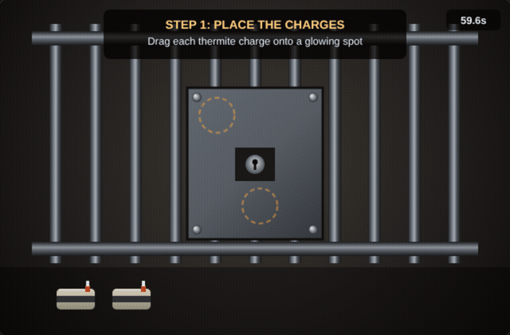

# KIO Thermite

A hands-on thermite minigame for FiveM. No clicking a progress bar: the player **places the charges**, **strikes a lighter and lights the fuse**, then **controls the burn**, holding the heat inside a moving green band until the lock melts through.

- Your character does it too: the charge in hand, planted on the door with the Pacific Standard thermal charge animation, a lighter that actually flames when the strike catches, then they shield their eyes while the real thermite burn plays on the gate
- Standalone: works on Qbox, QBCore, ESX, vRP or no framework at all
- One export, three clear results: opened, failed, backed out
- 4 difficulty presets (easy, normal, hard, vault) plus per-call overrides
- Live sound effects (lighter strike, fuse hiss, the burn rising with the heat), made in the browser, no audio files
- Every word in `config.lua`, so it's easy to translate
- Sits off to the side by default so players can watch their character work (theme, size, position and dim in the config)
- `/thermitetest` command to try it anywhere
- Free. Made by KIO Labs for Nior City RP.



## Install

1. Drop the `kio_thermite` folder into your `resources`.
2. Add `ensure kio_thermite` to your `server.cfg`.
3. Restart the server, then try `/thermitetest` in game (admins).

## Use it

```lua
local result = exports.kio_thermite:Start('normal')

if result == true then
    -- the lock melted: open your door
elseif result == false then
    -- it went wrong: remove the thermite, start a fire
else
    -- nil: the player pressed ESC before lighting it; keep their thermite
end
```

`Start` blocks until the player finishes, so call it from a thread (`CreateThread`) or a target/menu callback.

| Export | What it does |
|---|---|
| `Start(opts)` | Opens the minigame and returns `true`, `false` or `nil` |
| `StartAsync(opts, cb)` | Same thing without blocking: `cb(result)` |
| `IsOpen()` | `true` while it is on screen |

`opts` can be a preset name (`'easy'`, `'normal'`, `'hard'`, `'vault'`) or a table:

```lua
exports.kio_thermite:Start({ preset = 'hard', meltSeconds = 8, timeLimit = 12 })

-- put the charge on the exact door (the character turns to it); otherwise it goes in front of them
exports.kio_thermite:Start({ preset = 'hard', coords = vec3(253.3, 221.1, 106.3), heading = 160.0 })
```

| Setting | Meaning |
|---|---|
| `rise` / `fall` | How fast the heat climbs while held / cools when released (per second) |
| `band` | Half the height of the green band (0..1) |
| `drift` | How fast the green band wanders |
| `hotLimit` / `coldLimit` | Seconds outside the band before it blows out / dies |
| `meltSeconds` | Seconds in the green needed to melt the lock |
| `timeLimit` | Seconds to place the charges and light the fuse |
| `catchChance` | Chance each lighter strike catches |

## Hook it into your heists

### ox_doorlock (any door)

```lua
-- client: on your own thermite item or target option
CreateThread(function()
    local result = exports.kio_thermite:Start('hard')
    if result == true then
        TriggerServerEvent('myheist:thermiteWorked', doorId)   -- server: exports.ox_doorlock:setDoorState(doorId, 0)
    elseif result == false then
        TriggerServerEvent('myheist:thermiteFailed')            -- remove the item, start a fire
    end
end)
```

### qbx_bankrobbery / qb-bankrobbery

Find where the script starts its own thermite minigame (search for `thermite` in `client/powerstation.lua`, `client/paleto.lua`, `client/pacific.lua`) and swap the call:

```lua
CreateThread(function()
    local r = exports.kio_thermite:Start('normal')
    if r == nil then ClearPedTasks(cache.ped) return end   -- backed out: nothing used
    -- r is true or false: pass it to the script's existing success/fail code
end)
```

On Nior City we keep the fallback to the old minigame in case this resource isn't running:

```lua
local r
if GetResourceState('kio_thermite') == 'started' then r = exports.kio_thermite:Start()
else r = exports.bl_ui:PathFind(2, { numberOfNodes = 10, duration = 8000 }) end
```

## Config

Everything is in `config.lua`: presets, the default preset, the character animation (turn it off with `Config.Animation.enabled = false`), volume, theme colors and size, the test command, and every line of text.

## Controls

- **Mouse**: drag the charges, click the lighter to strike it, drag the lit lighter to the fuse
- **Space** or **right click** (hold): add heat
- **ESC**: back out before the fuse is lit (keeps the player's thermite)

## License

Free to use on any server, and free to edit for your own server. Don't resell it or re-upload it as your own. See `LICENSE`.

Made by **KIO Labs**. Latest version: https://github.com/KioLabs/kio_thermite/releases
